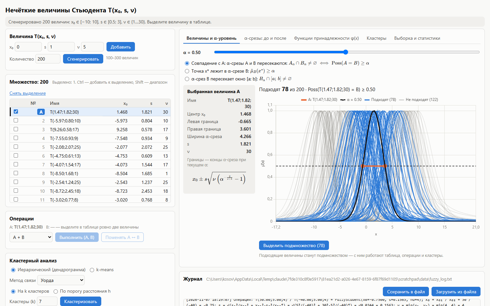
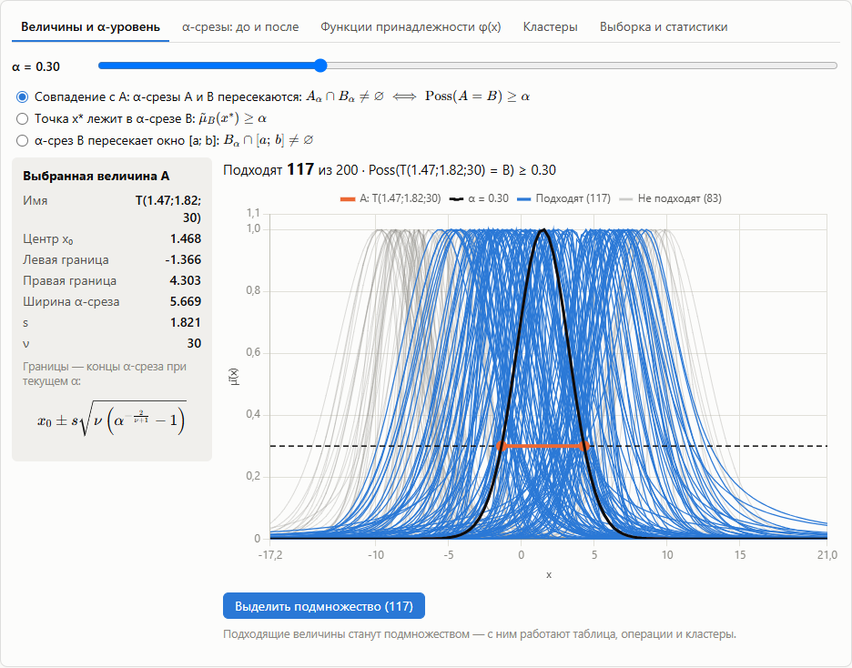
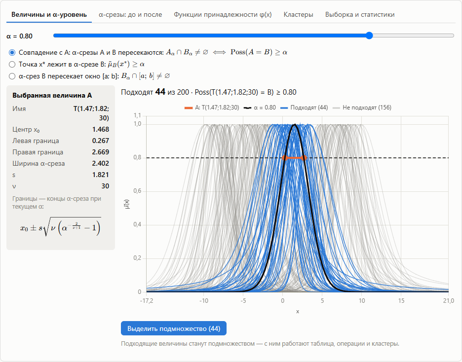
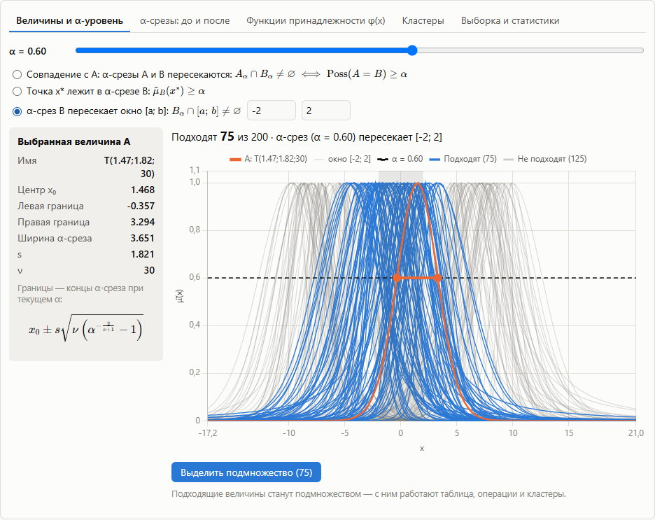
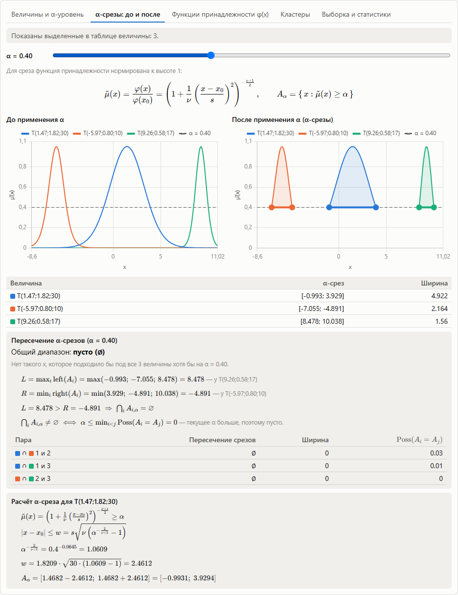
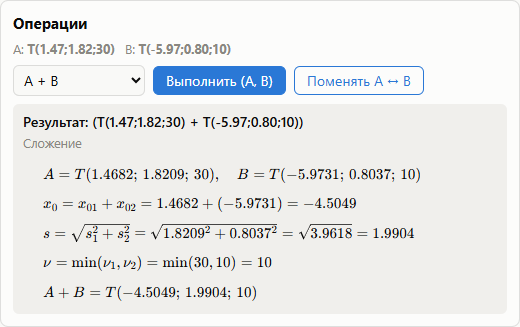
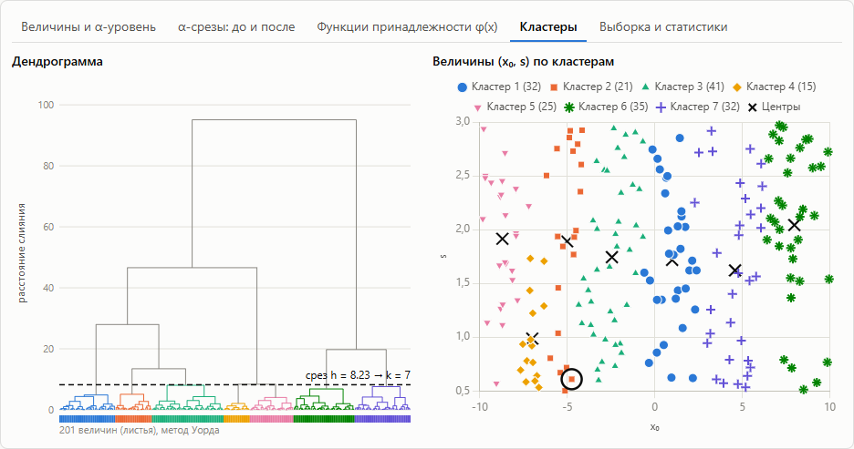
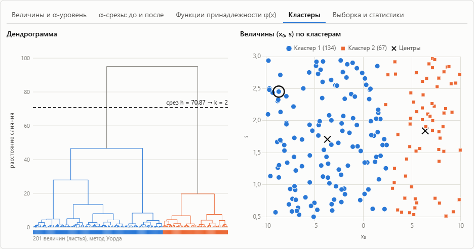

# Нечёткие величины Стьюдента

Пояснительная записка к комплексному практическому занятию по дисциплине «Неклассические логики»
(МАИ, институт № 8).

**Репозиторий:** https://github.com/USERNAME/fuzzy-student <!-- замените на адрес своего репозитория -->

Комплекс программ работает с нечёткими величинами, функция принадлежности которых задана
**распределением Стьюдента**. Он выполняет операции над величинами, генерирует их множество,
выделяет подмножества по уровню α и проводит кластерный анализ.



---

## Содержание

1. [Задание](#1-задание)
2. [Математика](#2-математика)
3. [Решение](#3-решение)
4. [Развёртывание: установка и запуск](#4-развёртывание-установка-и-запуск)
5. [Работа с программой и пример работы](#5-работа-с-программой-и-пример-работы)
6. [Библиотека fuzzy-lib: API](#6-библиотека-fuzzy-lib-api)
7. [Журнал и файлы](#7-журнал-и-файлы)
8. [Литература](#8-литература)

---

## 1. Задание

Разработать программу, которая работает с нечёткими величинами одного вида (вариант —
распределение Стьюдента, справочник [1], стр. 70–71) и проводит кластерный анализ множества
нечётких величин. Состав работы:

| Требование | Где реализовано |
|---|---|
| Представление величины и множества величин | `FuzzyStudent`, `FuzzySet` — разделы [2.1](#21-нечёткая-величина-tx₀-s-ν), [3](#3-решение) |
| Присвоение, ввод, вывод на экран и в журнал | веб-интерфейс, журнал `data/fuzzy_log.txt` — разделы [5](#5-работа-с-программой-и-пример-работы), [7](#7-журнал-и-файлы) |
| Сложение, вычитание, умножение, деление, сравнение | [2.5](#25-операции-над-величинами) |
| Генерация 100–300 величин | [2.7](#27-генерация-множества-величин) |
| Кластерный анализ по критерию и на заданное число кластеров | [2.9](#29-кластерный-анализ) |
| Выделение подмножества, α-срезы «до и после» | [2.3](#23-α-срез), [2.4](#24-отбор-величин-по-уровню-α) |
| Процедуры — независимой библиотекой | пакет `fuzzy-lib` — [раздел 6](#6-библиотека-fuzzy-lib-api) |

## 2. Математика

### 2.1. Нечёткая величина T(x₀, s, ν)

Справочник [1] (табл. 2.2.5, стр. 70) даёт плотность распределения Стьюдента с k степенями
свободы:

$$S_k(t)=\frac{\Gamma\left(\frac{k+1}{2}\right)}{\sqrt{k\pi}\;\Gamma\left(\frac{k}{2}\right)}\left(1+\frac{t^2}{k}\right)^{-\frac{k+1}{2}},\qquad -\infty<t<+\infty .$$

Её центр всегда в нуле, а k меняет только форму («толщину хвостов»). Чтобы задавать величины
вида «примерно 5», вводим сдвиг и масштаб заменой $t = \dfrac{x - x_0}{s}$. Так же получается
нормальная величина $N(x_0, \sigma)$: справочник на стр. 65 пишет $x' = \sigma\eta + x_0$.

| Параметр | Смысл | Аналог у $N(x_0, \sigma)$ |
|---|---|---|
| $x_0$ | центр — «примерно сколько» | $x_0$ |
| $s > 0$ | масштаб — ширина, степень неопределённости | $\sigma$ |
| $\nu \in \{1, 2, \ldots\}$ | число степеней свободы (k в справочнике) — толщина хвостов | — |

**Функция принадлежности** — плотность со сдвигом и масштабом (как в учебном примере у нормальной
величины):

$$\varphi(x)=\frac{\Gamma\left(\frac{\nu+1}{2}\right)}{s\sqrt{\nu\pi}\;\Gamma\left(\frac{\nu}{2}\right)}\left(1+\frac{1}{\nu}\left(\frac{x-x_0}{s}\right)^2\right)^{-\frac{\nu+1}{2}} .$$

Множитель $\frac{1}{s}$ появляется при замене переменной, иначе площадь под графиком не была бы
равна 1. При $\nu = 1$ получается распределение Коши, при $\nu \to \infty$ — нормальное
распределение $N(x_0, s)$.

**Нормированная функция принадлежности** (высота 1) используется для α-срезов и отбора по α.
Нормирующий множитель с гамма-функциями сокращается:

$$\tilde\mu(x)=\frac{\varphi(x)}{\varphi(x_0)}=\left(1+\frac{1}{\nu}\left(\frac{x-x_0}{s}\right)^2\right)^{-\frac{\nu+1}{2}},\qquad \tilde\mu(x_0)=1 .$$

Без нормировки высота кривой $\varphi(x_0)$ зависит только от s и ν, а не от положения величины. Тогда
сравнение «высоты с уровнем α» не было бы α-срезом.

### 2.2. Теоретические характеристики

| Характеристика | Значение | Существует при |
|---|---|---|
| Математическое ожидание | $M = x_0$ | $\nu > 1$ |
| Дисперсия | $D = \dfrac{s^2\nu}{\nu - 2}$ | $\nu > 2$ |
| Асимметрия | $S_k = 0$ | $\nu > 3$ |
| Эксцесс | $E_x = \dfrac{6}{\nu - 4}$ | $\nu > 4$ |

### 2.3. α-срез

α-срез — множество x, у которых степень принадлежности не меньше α:

$$A_\alpha = \{\, x : \tilde\mu(x) \ge \alpha \,\},\qquad \alpha \in (0;\,1].$$

*Вывод.* Обозначим $z = \dfrac{x - x_0}{s}$:

$$\left(1+\frac{z^2}{\nu}\right)^{-\frac{\nu+1}{2}}\ge\alpha
\;\Longleftrightarrow\;
1+\frac{z^2}{\nu}\le\alpha^{-\frac{2}{\nu+1}}
\;\Longleftrightarrow\;
z^2\le\nu\left(\alpha^{-\frac{2}{\nu+1}}-1\right)$$

(показатель $-\frac{2}{\nu+1}$ отрицательный, поэтому знак неравенства меняется). Отсюда
α-срез — отрезок с центром $x_0$:

$$A_\alpha=[x_0-w;\;x_0+w],\qquad w(\alpha)=s\sqrt{\nu\left(\alpha^{-\frac{2}{\nu+1}}-1\right)} .$$

Концы отрезка — **левая и правая граница** величины при данном α, их показывает панель
выбранной величины. При $\alpha = 1$ срез — точка $x_0$. При $\alpha \to 0$ срез расширяется до
всей оси, так как у Стьюдента функция принадлежности нигде не равна нулю.

*Пример.* $T(30;\,5;\,4)$, $\alpha = 0.5$:
$\alpha^{-2/5} = 0.5^{-0.4} = 1.3195$, $w = 5\sqrt{4\,(1.3195 - 1)} = 5.6525$,
$A_{0.5} = [24.35;\;35.65]$.

**Пересечение α-срезов нескольких величин** — значения x, подходящие под все величины сразу:

$$\bigcap_i A_{i,\alpha} = \Big[\max_i \operatorname{left}(A_{i,\alpha});\;\min_i \operatorname{right}(A_{i,\alpha})\Big],$$

пустое, если левый конец больше правого. Срезы — отрезки на прямой, поэтому общая точка есть
тогда и только тогда, когда пересекается каждая пара:
$\bigcap_i A_{i,\alpha} \ne \varnothing \iff \alpha \le \min_{i<j} \operatorname{Poss}(A_i = A_j)$.

### 2.4. Отбор величин по уровню α

У Стьюдента $\tilde\mu(x) > 0$ при всех x, поэтому любая кривая пересекает любую линию α.
Сказать «величина проходит уровень α» можно только относительно какого-то объекта. Программа
поддерживает три критерия. Каждый задаёт **степень** $d(B) \in [0;\,1]$, и величина B проходит,
если $d(B) \ge \alpha$:

| Критерий | Степень $d(B)$ | Смысл |
|---|---|---|
| **Совпадение с выбранной A** (по умолчанию) | $\operatorname{Poss}(A = B) = \sup\limits_x \min\big(\tilde\mu_A(x),\, \tilde\mu_B(x)\big)$ | $A_\alpha \cap B_\alpha \ne \varnothing$ |
| **Точка $x^*$** | $\tilde\mu_B(x^*)$ | $x^* \in B_\alpha$ |
| **Окно $[a;\,b]$** | $\sup\limits_{x \in [a;\,b]} \tilde\mu_B(x)$ | $B_\alpha \cap [a;\,b] \ne \varnothing$ |

*Возможность равенства.* Обе функции симметричны и убывают от центра. Поэтому
$\operatorname{Poss}(A = B)$ — это наибольшее α, при котором срезы ещё касаются:

$$\lvert x_0^A - x_0^B \rvert = w_A(\alpha) + w_B(\alpha).$$

Ширина $w(\alpha)$ монотонно убывает, поэтому это α находится делением отрезка $[0;\,1]$ пополам
(60 шагов, точность $10^{-18}$). Для $A = B$ значение равно 1.

*Окно.* Степень равна 1, если $x_0$ лежит в окне, иначе это $\tilde\mu$ в ближайшем к $x_0$ конце
окна. Критерий «точка» — частный случай окна при $a = b = x^*$.

Чем больше α, тем уже срезы и **тем меньше величин проходит** по любому из критериев. Прошедшие
величины можно выделить в подмножество.

### 2.5. Операции над величинами

Формулы взяты из учебного примера (`FuzzyNormal`), σ заменяется на s. Третий параметр
считается по правилу $\nu = \min(\nu_1, \nu_2)$: у результата хвосты не тоньше, чем у самой
«неопределённой» из исходных величин. Пусть $A = T(x_{01}, s_1, \nu_1)$, $B = T(x_{02}, s_2, \nu_2)$.

| Операция | $x_0$ | $s$ |
|---|---|---|
| $A \pm B$ | $x_{01} \pm x_{02}$ | $\sqrt{s_1^2 + s_2^2}$ |
| $A \times B$ | $x_{01}\,x_{02}$ | $\sqrt{x_{01}^2 s_2^2 + x_{02}^2 s_1^2}$ |
| $A \div B$, $x_{02} \ne 0$ | $\dfrac{x_{01}}{x_{02}}$ | $\sqrt{\dfrac{s_1^2}{x_{02}^2} + \dfrac{x_{01}^2 s_2^2}{x_{02}^4}}$ |
| $A \pm c$ | $x_{01} \pm c$ | $s_1$ |
| $A \cdot c$, $A / c$ | $x_{01} c$, $\dfrac{x_{01}}{c}$ | $\lvert s_1 c \rvert$, $\dfrac{s_1}{\lvert c \rvert}$ |

*Вывод.*
- **Сложение и вычитание.** Для независимых величин $D(A \pm B) = D(A) + D(B)$.
- **Умножение и деление — линеаризация** функции $f(X, Y)$ около $(x_{01}, x_{02})$:

$$XY \approx x_{01}x_{02} + x_{02}(X - x_{01}) + x_{01}(Y - x_{02}) \;\Rightarrow\; D(XY) \approx x_{02}^2 D(X) + x_{01}^2 D(Y),$$

$$\frac{X}{Y} \approx \frac{x_{01}}{x_{02}} + \frac{X - x_{01}}{x_{02}} - \frac{x_{01}(Y - x_{02})}{x_{02}^2} \;\Rightarrow\; D\!\left(\frac{X}{Y}\right) \approx \frac{D(X)}{x_{02}^2} + \frac{x_{01}^2 D(Y)}{x_{02}^4}.$$

- **Деление на величину с $\lvert x_{02} \rvert < 10^{-9}$ запрещено.**

**Сравнение** — как в примере, по центрам: $A < B \iff x_{01} < x_{02}$. Дополнительно программа
выводит $\operatorname{Poss}(A = B)$ (раздел 2.4).

*Пример (так расчёт показывает программа).* $A = T(2;\,1;\,4)$, $B = T(3;\,2;\,6)$:

$$x_0 = 2 + 3 = 5,\qquad s = \sqrt{1^2 + 2^2} = 2.2361,\qquad \nu = \min(4, 6) = 4,\qquad A + B = T(5;\,2.2361;\,4).$$

### 2.6. Генерация случайных значений (справочник, табл. 2.2.5)

В строке варианта табл. 2.2.5 кроме плотности есть «формула получения случайной величины». Она
реализована в библиотеке (`sample`, `sampleStatistics`) вместе с оценками по табл. 2.2.7 — так же,
как `sample_statistics` в учебном примере. В интерфейсе, как и в примере, она не выводится;
правильность генератора проверяют автоматические тесты (раздел 3.3).

- **Равномерная величина** $\xi \in [0;\,1)$ — встроенный датчик.
- **Нормированная нормальная величина** η (стр. 65). Сумма n равномерных величин имеет среднее
  $\frac{n}{2}$ и дисперсию $\frac{n}{12}$, по центральной предельной теореме:

$$\omega_n=\frac{\sum_{i=1}^{n}\xi_i-\frac n2}{\sqrt{n/12}},\qquad
\eta=\omega_n-\frac{1}{20n}\left(\omega_n^3-3\omega_n\right),\quad n=12 .$$

- **Величина Стьюдента** с k степенями свободы (стр. 71). По определению
  $t = \dfrac{Z}{\sqrt{\chi^2_k / k}}$:

$$t=\frac{\eta_{k+1}}{\sqrt{\frac1k\sum_{i=1}^{k}\eta_i^2}},\qquad x' = s\,t + x_0 .$$

  В скане справочника под корнем пропущен квадрат. По определению там сумма **квадратов**, это
  подтверждают тесты: выборочная дисперсия совпадает с $\frac{k}{k-2}$.

- **Статистики выборки** — по табл. 2.2.7:

| Параметр | Формула |
|---|---|
| Математическое ожидание | $\bar x = \dfrac{1}{n}\sum\limits_{i=1}^{n} x_i$ |
| Дисперсия, $n > 40$ | $s^2 = \dfrac{1}{n}\sum\limits_{i=1}^{n} x_i^2 - \bar x^2$ |
| Дисперсия, $n \le 40$ | $s_1^2 = \dfrac{n}{n-1}\, s^2$ |
| Асимметрия | $S_k = \dfrac{m_3}{s^3}$ |
| Эксцесс | $E_x = \dfrac{m_4}{s^4} - 3$ |

где $m_k = \dfrac{1}{n}\sum\limits_{i=1}^{n} (x_i - \bar x)^k$ — эмпирический центральный момент.

При $\nu \le 2$ дисперсия бесконечна, и выборочные оценки сильно колеблются. Это свойство самого
распределения, а не ошибка программы.

### 2.7. Генерация множества величин

Генерируется $n = 100 \ldots 300$ величин (по умолчанию 200). Параметры каждой выбираются по
формуле равномерного распределения $x' = (b - a)\,\xi + a$: $x_0 \in [-10;\,10]$,
$s \in [0.5;\,3]$, $\nu$ — целое от 1 до 30.

### 2.8. Расстояние между величинами

Каждая величина $T(x_0, s, \nu)$ представлена точкой $(x_0, s)$. Расстояние — евклидово:

$$d(A,B)=\sqrt{(x_0^A-x_0^B)^2+(s^A-s^B)^2}.$$

Признаки не нормируются, как в примере. При генерации по умолчанию разброс x₀ (около 20) больше
разброса s (около 2.5), поэтому кластеры делятся в основном по положению.

### 2.9. Кластерный анализ

**Основной метод — иерархическая (агломеративная) кластеризация.**

1. Сначала каждая величина — отдельный кластер.
2. На каждом шаге сливаются два ближайших кластера. Расстояние от нового кластера $i \cup j$ до
   любого другого $k$ пересчитывается по формуле Ланса — Уильямса:

| Метод связи | $d(i \cup j,\, k)$ |
|---|---|
| Уорда (по умолчанию) | $\sqrt{\dfrac{(n_i + n_k)\,d_{ik}^2 + (n_j + n_k)\,d_{jk}^2 - n_k\,d_{ij}^2}{n_i + n_j + n_k}}$ |
| дальнего соседа | $\max(d_{ik},\, d_{jk})$ |
| средней связи | $\dfrac{n_i\,d_{ik} + n_j\,d_{jk}}{n_i + n_j}$ |
| ближнего соседа | $\min(d_{ik},\, d_{jk})$ |

3. После n − 1 слияний получается дерево — **дендрограмма**. Высота каждого слияния — расстояние
   между слитыми кластерами, и для всех четырёх методов она не убывает.

**Разбиение получается разрезом дерева горизонтальной линией** — это и закрывает оба требования
задания:

- **на заданное число кластеров k:** выполняются первые n − k слияний. Линия среза проводится
  посередине между (n − k)-м и (n − k + 1)-м слиянием;
- **по критерию — порогу расстояния h:** выполняются слияния с высотой ≤ h. Кластеры — это
  группы величин, которые объединяются на расстоянии не больше h.

Дерево строится один раз, а при смене k или h заново выполняется только разрез. Поэтому
дендрограмма, линия среза, цвета точек и столбец кластера в таблице перестраиваются сразу.
Кластеры нумеруются слева направо по дендрограмме, так что цвет ветви совпадает с цветом точек.

**Качество разбиения** — внутрикластерная сумма квадратов расстояний:

$$J = \sum_{j=1}^{k} \sum_{A \in K_j} d(A,\, c_j)^2,$$

где $c_j$ — центр кластера $K_j$.

**Дополнительный метод — k-means**, как в учебном примере:
1. начальные центры — k случайных величин;
2. каждая величина относится к ближайшему центру;
3. центры пересчитываются как средние;
4. шаги 2–3 повторяются до стабилизации.

Если кластер оказался пустым, в него переносится самая удалённая величина.

## 3. Решение

### 3.1. Архитектура

```
fuzzy-student/
├── packages/fuzzy-lib/   независимая библиотека (TypeScript; не зависит от браузера и файлов)
│   ├── src/FuzzyStudent.ts   величина: φ(x), μ̃(x), α-срез, Poss(A = B), + − × ÷, сравнение
│   ├── src/FuzzySet.ts       множество, подмножества, критерии отбора по α, сериализация
│   ├── src/hierarchical.ts   иерархическая кластеризация, разрез дерева, геометрия дендрограммы
│   ├── src/kmeans.ts         k-means, расстояние между величинами
│   ├── src/random.ts         датчики ξ, η, t по справочнику
│   ├── src/stats.ts          статистики по табл. 2.2.7
│   ├── src/generator.ts      генерация набора величин
│   ├── src/logger.ts         журнал с метками времени
│   ├── src/special.ts        гамма-функция (Ланцош)
│   └── test/                 автоматические тесты (vitest)
├── server/               Node.js + Express: журнал fuzzy_log.txt, файл fuzzy_set.json
├── web/                  интерфейс: React + TypeScript, графики Chart.js, дендрограмма — SVG
├── docs/img/             скриншоты
└── data/                 создаётся при запуске: fuzzy_log.txt, fuzzy_set.json
```

Структура повторяет учебный пример: в примере есть библиотека `fuzzy_lib` и программа `gui.py`,
которая её использует. Здесь библиотека — пакет `fuzzy-lib`, программа — веб-интерфейс `web` с
сервером `server`. Интерфейс вызывает только функции библиотеки. Любая другая программа на
JS/TS может подключить её так же.

### 3.2. Как реализованы ключевые части

- **Представление величины** — неизменяемый объект с полями x₀, s, ν и именем. Конструктор
  проверяет s > 0 и что ν — целое ≥ 1.
- **Множество** — упорядоченный список величин.
  - Подмножество получается по индексам, по предикату, по диапазонам параметров или по критерию
    α.
  - Подмножество ссылается на те же объекты, величины не копируются.
- **Операции** — функция `FuzzyStudent.operate(A, op, B)`. Она возвращает результат и список шагов
  расчёта с подставленными числами, интерфейс показывает их под кнопкой «Выполнить».
- **Гамма-функция** вычисляется в логарифмической форме (аппроксимация Ланцоша), поэтому при
  больших ν нет переполнения.
- **Отбор по α.**
  - Для каждой величины один раз вычисляется степень d(B) по выбранному критерию.
  - При движении ползунка α выполняется только сравнение d(B) ≥ α, поэтому даже при 300 кривых
    график и счётчик обновляются плавно.
- **Иерархическая кластеризация.**
  - Матрица расстояний обновляется по формуле Ланса — Уильямса, сложность O(n³). Для 300 величин
    это доли секунды.
  - Дерево кэшируется по набору величин и методу связи, разрез по k или h выполняется за O(n).
- **Дендрограмма** рисуется в SVG: П-образные соединения, окраска ветвей по кластерам, пунктирная
  линия среза, цветная полоса под листьями.
- **Журнал и файлы.** Браузер не может писать на диск, поэтому интерфейс отправляет записи на
  сервер (раздел 7). Сервер пишет их через `Logger` из библиотеки.

### 3.3. Тестирование

Команда `npm test` запускает 43 автоматических теста библиотеки. Они проверяют:

- гамма-функцию;
- что ∫φ dx = 1, что при ν = 1 получается Коши, а при ν → ∞ — нормальное распределение;
- что на границах α-среза μ̃ = α;
- Poss(A = B): Poss(A = A) = 1, симметричность, касание срезов;
- что точка — частный случай окна и что при росте α подходящих не становится больше;
- пересечение α-срезов нескольких величин и границу α, на которой оно исчезает;
- статистики датчиков (M, D для η и t);
- формулы табл. 2.2.7;
- операции, их совпадение с формулами примера, деление на x₀ ≈ 0;
- высоты слияний для всех методов связи на известном примере;
- разрез на k и по h, вложенность разбиений 7 → 2;
- k-means;
- сохранение и загрузку множества.

## 4. Развёртывание: установка и запуск

**Требования:** Node.js 20 или новее (https://nodejs.org), Windows / macOS / Linux, любой
современный браузер.

```bash
git clone https://github.com/USERNAME/fuzzy-student.git
cd fuzzy-student
npm install        # зависимости — один раз
npm start          # сборка и запуск
```

После `npm start` откройте **http://localhost:3001**.

| Команда | Что делает |
|---|---|
| `npm start` | собирает библиотеку и интерфейс и запускает сервер — программа на http://localhost:3001 |
| `npm run dev` | режим разработки с автоперезагрузкой — http://localhost:5173 |
| `npm test` | тесты библиотеки |
| `npm run build` | только сборка (`packages/fuzzy-lib/dist`, `web/dist`) |

Журнал и сохранённое множество лежат в папке `data/`. Другую папку можно задать переменной
окружения `DATA_DIR`, порт — переменной `PORT`.

## 5. Работа с программой и пример работы

Слева — ввод, таблица величин и панели управления, справа — вкладки с графиками и журнал.

| Элемент | Действие |
|---|---|
| **Величина T(x₀, s, ν)** | ввести x₀, s > 0, целое ν ≥ 1 и нажать «Добавить» |
| **Сгенерировать** | новый набор из 100–300 величин |
| **Таблица** | щелчок — выбрать величину (она становится **A**); Ctrl + щелчок — добавить к выделению (вторая — **B**); Shift + щелчок — диапазон |
| **Изменить величину** (вкладка «Функции принадлежности φ(x)») | ползунки и поля x₀, s, ν для величины A: кривая и строка таблицы меняются сразу; в журнал пишется «было → стало»; «Вернуть исходные» — отмена; кластеры после правки сбрасываются |
| **Какие кривые показывать** (там же) | последние 30 (как в примере) / все / только выделенные |
| **Связь таблицы и графиков** | наведение на строку подсвечивает её кривую (толстая контрастная линия поверх остальных; на точках кластеров — кольцо); наведение на кривую подсвечивает строку; щелчок по кривой или точке выбирает величину так же, как щелчок по строке (Ctrl — добавить к выделению), и таблица прокручивается к ней |
| **Операции** | A + B, A − B, A × B, A ÷ B, сравнение; результат добавляется в множество, расчёт показывается по шагам |
| **Кластерный анализ** | метод (иерархический / k-means), метод связи, разрез «на k кластеров» или «по порогу h», кнопка «Кластеризовать»; дальше изменения применяются сразу |
| **Подмножество** | из выделенных строк, по диапазонам x₀/s/ν или по уровню α (вкладка «Величины и α-уровень»); переключатель «Всё множество / Подмножество» |
| **Журнал** | все действия с метками времени; «Сохранить в файл» / «Загрузить из файла» — `fuzzy_set.json` |

### 5.1. Величины и α-уровень

На графике **все величины** нарисованы тонкими линиями, пунктир — уровень α. Слева показаны
параметры выбранной величины A: центр, **левая и правая граница** α-среза, s, ν. При движении
ползунка α меняется число подходящих величин: они выделены синим, остальные — серым.

| α = 0.3 | α = 0.8 — срезы уже, подходящих меньше |
|---|---|
|  |  |

Критерий «окно [a; b]» — окно закрашено полосой:



Кнопка «Выделить подмножество» делает подходящие величины подмножеством. Дальше таблица,
операции и кластеризация работают с ним.

### 5.2. α-срезы: до и после

Слева — функции принадлежности **до** применения α, справа — **после**: остаётся часть графика
выше уровня α, сам срез выделен отрезком. Ниже — таблица срезов и расчёт по шагам.

Карточка **«Пересечение α-срезов»** даёт общий диапазон выделенных величин:

$$[L;\,R] = \Big[\max_i \operatorname{left}(A_{i,\alpha});\;\min_i \operatorname{right}(A_{i,\alpha})\Big].$$

Это значения x, которые подходят под **все** величины одновременно со степенью не ниже α.
- Если $L > R$, общих значений нет.
- Общий диапазон существует при $\alpha \le \min_{i<j} \operatorname{Poss}(A_i = A_j)$. Срезы —
  отрезки на прямой, поэтому все они имеют общую точку тогда и только тогда, когда пересекается
  каждая пара.
- Для 2–4 величин дополнительно показаны пересечения каждой пары.

На графике «после» общий диапазон закрашен серой полосой.



### 5.3. Операции



### 5.4. Кластеры: 7 → 2

Слева дендрограмма, справа величины (x₀, s) по кластерам. При смене k с 7 на 2 перестраиваются
окраска дерева, линия среза, точки и таблица.

| k = 7 | k = 2 |
|---|---|
|  |  |

Ошибки ввода (s ≤ 0, дробное ν, деление на величину с x₀ ≈ 0, порог h, дающий больше
8 кластеров) выводятся в строке состояния под заголовком.

## 6. Библиотека fuzzy-lib: API

```ts
import {
  FuzzyStudent, FuzzySet, generateSet, hierarchical, buildHierarchy, cutHierarchy, kmeans, Logger,
} from "fuzzy-lib";

const a = new FuzzyStudent(2, 1, 4, "A");   // T(x₀ = 2, s = 1, ν = 4)
const b = new FuzzyStudent(3, 2, 6, "B");

a.membership(2.5);            // φ(2.5)
a.membershipNormalized(2.5);  // μ̃(2.5) ∈ (0, 1]
a.alphaCut(0.5);              // { alpha, left, right }
a.possibilityEqual(b);        // Poss(A = B)

const c = a.add(b);           // также sub, mul, div — с величиной или числом
const { result, steps } = FuzzyStudent.operate(a, "/", b);  // результат + расчёт по шагам
a.compareTo(b);               // −1 | 0 | 1 по x₀

const set = generateSet(200);
set.filterByAlpha({ kind: "possibility", reference: a }, 0.5);  // отбор по α
set.filterByAlpha({ kind: "window", a: -2, b: 2 }, 0.5);
set.filterByRange({ x0: [0, 5] });

const r7 = hierarchical(set, { k: 7 }, "ward");           // дерево + разрез на 7
const tree = buildHierarchy(set.toArray(), "complete");
const byH = cutHierarchy(tree, set.toArray(), { height: 10 });  // разрез по порогу
const km = kmeans(set, 3);

new Logger((line) => console.log(line)).log("Готово");
```

| Экспорт | Назначение |
|---|---|
| `FuzzyStudent` | `membership`, `membershipNormalized`, `alphaCut`, `alphaHalfWidth`, `explainAlphaCut`, `possibilityEqual`, `alphaCutsIntersect`, `windowDegree`, `add/sub/mul/div`, `operate`, `compare`, `compareTo`, `equals`, `sample`, `sampleMany`, `sampleStatistics`, `theoretical`, `toDict/fromDict` |
| `FuzzySet` | `add`, `remove`, `get`, `size`, `last`, `subset`, `filterByRange`, `filterByAlpha`, `filterByAlphaCut`, `toList/fromList` |
| `alphaDegree`, `passesAlpha` | степень по критерию α и проверка d ≥ α |
| `intersectAlphaCuts`, `maxCommonAlpha` | общий диапазон α-срезов нескольких величин; наибольшее α, при котором он непуст |
| `buildHierarchy`, `cutHierarchy`, `hierarchical`, `dendrogramLinks` | иерархическая кластеризация, разрез на k / по h, геометрия дендрограммы |
| `kmeans`, `fuzzyDistance` | k-means и расстояние между величинами |
| `generateSet` | генерация набора величин |
| `Logger` | журнал с метками времени и произвольным приёмником строк |
| `normalBook`, `studentStandard`, `seededRng` | датчики по справочнику |
| `sampleStatistics` | оценки по табл. 2.2.7 |
| `lnGamma`, `gamma` | гамма-функция |

Сборка библиотеки — `npm run build:lib`. Результат с типами для TypeScript появляется в
`packages/fuzzy-lib/dist`.

## 7. Журнал и файлы

| Запрос | Действие |
|---|---|
| `POST /api/log` `{ "message": "…" }` | дописать строку `[ГГГГ-ММ-ДД чч:мм:сс] сообщение` в `data/fuzzy_log.txt` |
| `GET /api/log` | последние строки журнала |
| `POST /api/save` `[ {x0, s, nu, name}, … ]` | проверить данные и записать `data/fuzzy_set.json` |
| `GET /api/load` | прочитать `data/fuzzy_set.json` |

В журнал записываются:
- добавление и генерация величин;
- операции с расчётом и сравнения;
- кластеризация (метод, k или h, размеры, срез, J);
- α-уровень (критерий и число подходящих) и α-срезы;
- подмножества;
- изменение параметров величины («было → стало»);
- сохранение и загрузка.

Пример `fuzzy_set.json`:

```json
[
  { "x0": 1, "s": 2, "nu": 5, "name": "A" },
  { "x0": -3, "s": 0.5, "nu": 10, "name": "B" }
]
```

## 8. Литература

1. Абчук В. А. и др. Справочник по исследованию операций. — М.: Воениздат, 1979. — 368 с.
   (табл. 2.2.5 — получение случайных величин, табл. 2.2.7 — оценки параметров).
2. Демидова Л. А., Кираковский В. В., Пылькин А. Н. Алгоритмы и системы нечёткого вывода при
   решении задач диагностики городских инженерных коммуникаций.
3. Батыршин И. З. и др. Нечёткие гибридные системы. Теория и практика / Под ред.
   Н. Г. Ярушкиной. — М.: ФИЗМАТЛИТ, 2007. — 208 с.
# fuzzy-student

